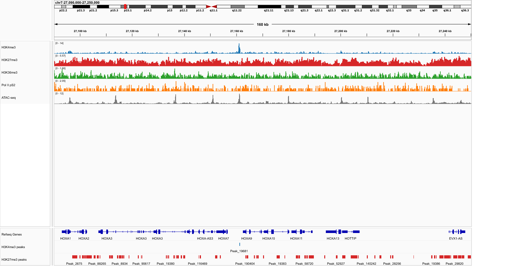
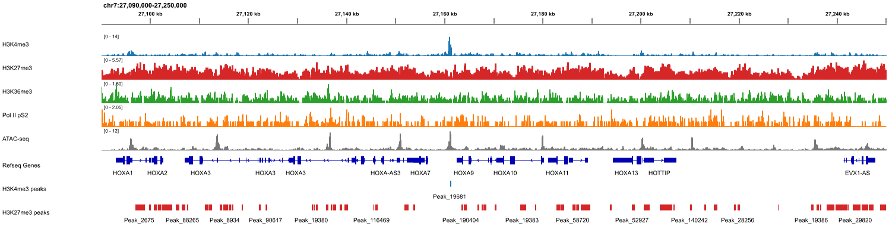
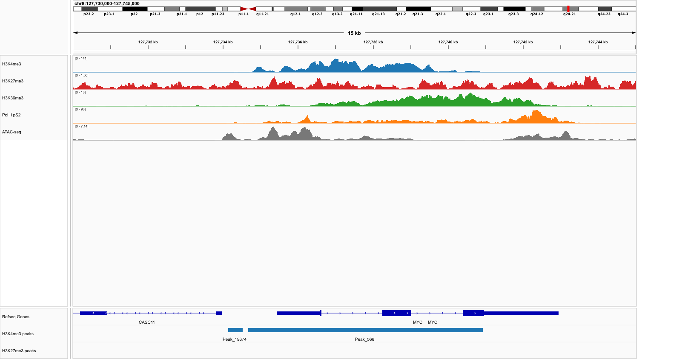
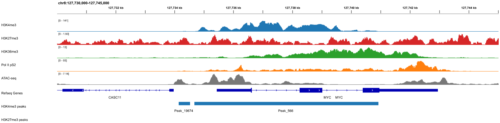
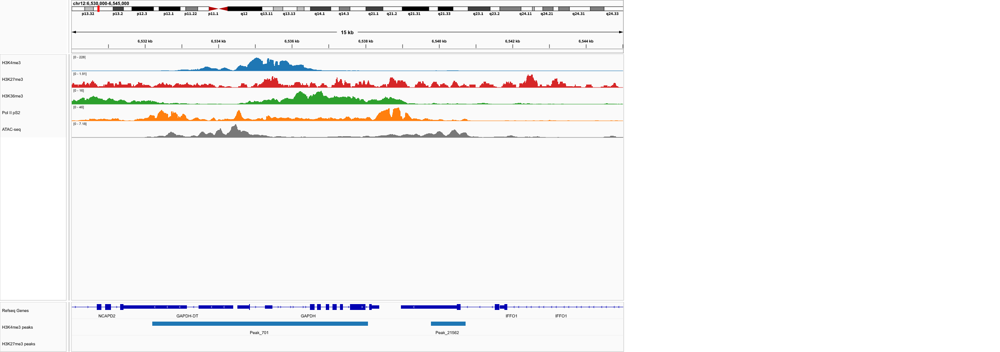
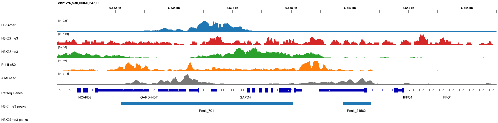

# minIGV

**Minimal, figure-ready IGV snapshots.**

IGV desktop can save the current view as SVG, but the file is full of screen
chrome you normally delete by hand in Illustrator: grey panel backgrounds,
silver borders, the chromosome ideogram and its red box, the span bar, Java's
`Dialog` font, empty panel padding — and tens of thousands of one-pixel
rectangles. minIGV removes all of that with rules based on IGV's own drawing
style, so it works on any locus and any set of tracks.

| IGV snapshot | after `minigv` |
|---|---|
|  |  |

*HOXA cluster, K562, public ENCODE data (see [Example data](#example-data)).*

## What it does

By default minIGV:

- removes near-white panel and track-name backgrounds, panel borders, divider and separator lines
- removes the cytoband ideogram (human and mouse band names), the red current-view box and the "N kb" span bar
- moves the locus label (`chr:start-end`) down next to the coordinate ruler
- replaces Java's `Dialog`/`SansSerif` fonts with Arial (`--font` to choose)
- closes the empty space IGV pads each panel with
- merges IGV's one-rectangle-per-bar drawing into one path per track — same picture, 10–50× fewer objects on the examples, so files are much lighter to edit in a vector editor
- sets a proper page size, cropped to the content

Track data, gene models, data-range labels (`[0 - 60]`), peak and gene names are never touched.
Optional: drop the ruler, the locus label or whole tracks; tidy or rename track names.

## Install

```bash
pip install git+https://github.com/yu-kuai/minIGV
```

This installs the `minigv` command and the `minigv` Python module. It needs only the
Python standard library (Python ≥ 3.9; tested with 3.9, 3.11, 3.12 and 3.14).
For the Jupyter widget, include the `interactive` extra (adds `ipywidgets`):

```bash
pip install "minigv[interactive] @ git+https://github.com/yu-kuai/minIGV"
```

No install needed if you prefer: `minigv.py` is a single file — download it and run
`python minigv.py ...`.

## Usage

### Command line

```bash
minigv snapshot.svg                      # -> snapshot.clean.svg
minigv snapshot.svg -o figure.svg --drop-ruler
minigv *.svg -o cleaned/ --report        # batch; print what was changed
minigv snapshot.svg --list-tracks        # track names, for --drop-track
minigv snapshot.svg --drop-track "H3K36me3" --drop-track "ATAC-seq"
```

### Python / Jupyter

```python
from minigv import clean_svg, list_tracks

fig = clean_svg("snapshot.svg", drop_ruler=True)
fig                 # inline preview in Jupyter
fig.compare()       # IGV original above the cleaned version
print(fig)          # what was removed / changed
fig.save("figure.svg")
```

### Interactive (Jupyter)

```python
from minigv import interactive
interactive("snapshot.svg")
```

Checkboxes for every cleaning step and every track, a live preview, a **Save SVG**
button, and — underneath — the exact `clean_svg(...)` call and command line that
reproduce your settings, ready to paste into a script for batch processing.

See [`notebooks/`](notebooks) for a tutorial and the interactive notebook.

### Options

| Python | Command line | Default | Effect |
|---|---|---|---|
| `keep_backgrounds` | `--keep-backgrounds` | off | keep grey panel backgrounds |
| `keep_borders` | `--keep-borders` | off | keep panel borders / separators |
| `keep_ideogram` | `--keep-ideogram` | off | keep the chromosome ideogram |
| `keep_span` | `--keep-span` | off | keep the "N kb" span bar |
| `drop_ruler` | `--drop-ruler` | off | remove the coordinate ruler |
| `drop_locus` | `--drop-locus` | off | remove the `chr:start-end` label |
| `drop_tracks=[...]` | `--drop-track NAME` | none | remove whole tracks (gap closes) |
| `compact=False` | `--no-compact` | on | don't move the locus label down |
| `keep_gaps` | `--keep-gaps` | off | keep IGV's empty panel padding |
| `gap`, `min_gap` | `--gap`, `--min-gap` | 10, 20 pt | close blank bands taller than `min_gap` down to `gap` |
| `crop=False` | `--no-crop` | on | don't crop the page to the content |
| `margin` | `--margin` | 4 pt | margin around the content |
| `font` | `--font` | Arial | replaces Java fonts (`keep` to leave) |
| `simplify=False` | `--no-simplify` | on | keep IGV's one-rect-per-bar structure |
| `tidy_names` | `--tidy-names` | off | join IGV's wrapped track names, drop `.bw`/`.bam`/… |
| `rename=` | `--rename FILE` | none | CSV/TSV of `old,new` track-name replacements |

## Example data

The examples use public ENCODE K562 data (GRCh38), streamed directly from the
ENCODE portal — no data is stored in this repository.

| Track | ENCODE file | Experiment |
|---|---|---|
| H3K4me3 (fold change over control) | [ENCFF806YEZ](https://www.encodeproject.org/files/ENCFF806YEZ/) | [ENCSR000EWA](https://www.encodeproject.org/experiments/ENCSR000EWA/) |
| H3K27me3 (fold change over control) | [ENCFF242ENK](https://www.encodeproject.org/files/ENCFF242ENK/) | [ENCSR000AKQ](https://www.encodeproject.org/experiments/ENCSR000AKQ/) |
| H3K36me3 (fold change over control) | [ENCFF317VHO](https://www.encodeproject.org/files/ENCFF317VHO/) | [ENCSR000AKR](https://www.encodeproject.org/experiments/ENCSR000AKR/) |
| Pol II pS2 (fold change over control) | [ENCFF434PYZ](https://www.encodeproject.org/files/ENCFF434PYZ/) | [ENCSR000EGF](https://www.encodeproject.org/experiments/ENCSR000EGF/) |
| ATAC-seq (fold change over control) | [ENCFF754EAC](https://www.encodeproject.org/files/ENCFF754EAC/) | [ENCSR483RKN](https://www.encodeproject.org/experiments/ENCSR483RKN/) |
| H3K4me3 replicated peaks | [ENCFF246IEW](https://www.encodeproject.org/files/ENCFF246IEW/) | [ENCSR000EWA](https://www.encodeproject.org/experiments/ENCSR000EWA/) |
| H3K27me3 replicated peaks | [ENCFF315MMU](https://www.encodeproject.org/files/ENCFF315MMU/) | [ENCSR000AKQ](https://www.encodeproject.org/experiments/ENCSR000AKQ/) |

- `examples/igv/encode_k562_session.xml` — IGV session with these tracks
- `examples/igv/make_snapshots.py` — drives a running IGV over its batch port to save the snapshots
- `examples/raw/` — IGV's SVG snapshots (HOXA, MYC, GAPDH)
- `examples/output/` — the same snapshots after `minigv`

| | IGV snapshot | after `minigv` |
|---|---|---|
| MYC |  |  |
| GAPDH |  |  |

## Notes and limitations

- Written for **IGV desktop** SVGs (Batik; tested with IGV 2.16). igv.js / IGV-Web SVGs are drawn differently and are not supported.
- The rules match IGV's default look. Heavily customised sessions may need a `--keep-*` flag; open an issue with an example if something is removed that shouldn't be.
- Some Python builds ship a broken XML parser (`No module named expat`, seen with some Homebrew Python 3.12+). Use another interpreter, e.g. the system `python3` or conda.

## License

[MIT](LICENSE)
